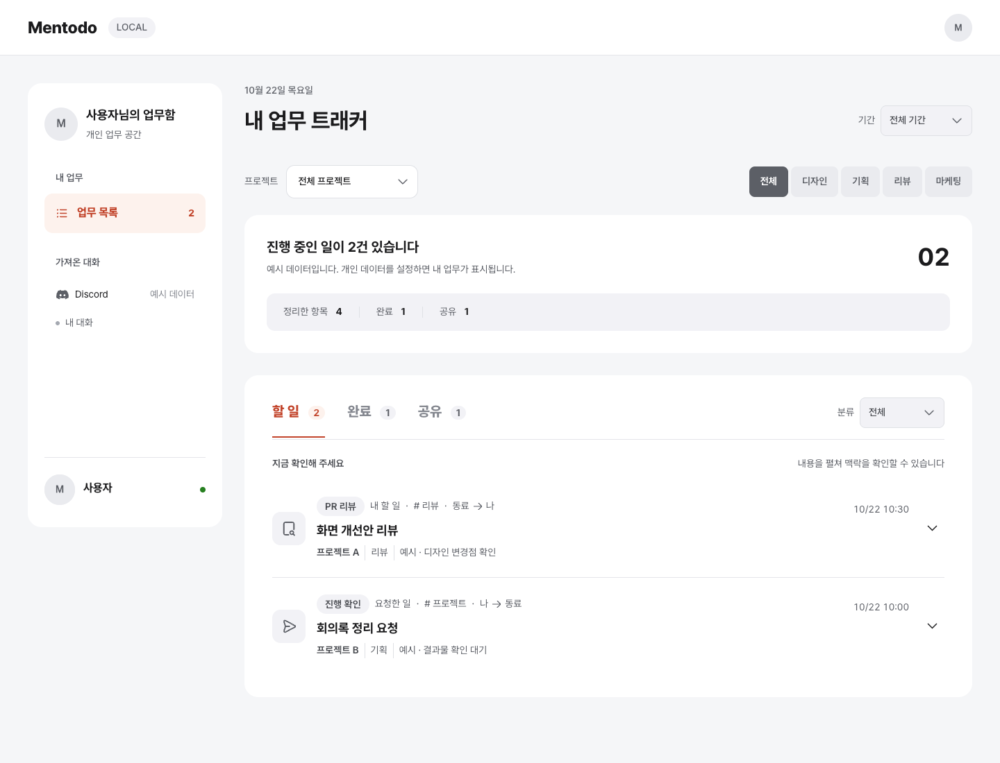

# Mentodo

디스코드 대화에서 내 할 일, 내가 요청한 일, 내가 한 질문, 공유 내용을 정리하는 **개인 업무 트래커**입니다. 대화의 맥락과 후속 결과를 확인한 데이터를 읽어 보여줍니다.

- 프로젝트와 디자인·기획·리뷰·마케팅 필터
- 원문·후속 근거 펼쳐보기, 완료 처리·되돌리기
- 한 컴퓨터에서 브라우저를 바꿔도 같은 완료 상태 유지
- 필요할 때 같은 네트워크에 조회용으로 공유

Codex로 대화를 확인해 개인 데이터 파일을 만들거나 직접 입력하는 방식입니다. **다운로드만으로 Discord 수집이나 예약 실행이 시작되지는 않습니다.** 매일 한국 시간 09·12·17시에 수집하려면 [정기 갱신 설정](docs/UPDATE.md)을 각자 등록합니다. 처음 실행하면 실제 사람의 대화가 아닌 예시 4건이 표시됩니다.



## 바로 실행

Python **3.10 이상**이 필요합니다. 아래 명령은 Git으로 내려받는 방법이며, Git 없이 받으려면 [ZIP 설치 방법](docs/SETUP.md#git-없이-zip으로-받은-경우)을 따릅니다. Node.js와 추가 Python 패키지는 필요하지 않습니다. 저장소가 비공개라면 먼저 GitHub 접근 권한을 받아야 합니다.

**macOS / Linux**

```sh
git clone https://github.com/kjmin9789/Mentodo.git
cd Mentodo
python3 server.py
```

**Windows PowerShell**

```powershell
git clone https://github.com/kjmin9789/Mentodo.git
cd Mentodo
py -3 server.py
```

브라우저에서 [localhost:4317](http://localhost:4317/)을 엽니다. 터미널을 켜둔 동안 실행되며 `Ctrl+C`로 종료합니다. 설치와 문제 해결은 [설치 가이드](docs/SETUP.md)에 정리했습니다.

## 프로젝트는 사용자마다 설정

공통 프로젝트 목록이나 자동 통합 규칙은 없습니다. `local/tasks.json`의 `project` 값으로 선택 목록을 만듭니다. 각 사용자가 본인의 실제 프로젝트를 새로 정하고, 서로 다른 프로젝트는 기본적으로 분리합니다. 예를 들어 아폴로와 종목필터 상품화는 각각 별도 이름으로 입력합니다. 합쳐 보려는 경우에만 본인의 개인 데이터에서 같은 이름을 사용합니다.

예시의 `프로젝트 A`, `프로젝트 B`는 사용법을 보여주기 위한 이름이며 자신의 분류로 바꿉니다. 다른 사용자의 프로젝트 구성을 그대로 가져올 필요는 없습니다.

## 내 데이터로 사용

1. `local/` 폴더를 만들고, [프로필 예시](examples/profile.json)를 `local/profile.json`으로 복사해 본인 이름을 적습니다.
2. [대화 수집 가이드와 복사용 프롬프트](docs/COLLECT.md)를 사용해 본인의 `local/tasks.json`을 만듭니다. 형식은 [데이터 작성 가이드](docs/DATA.md)를 따릅니다.
3. `python3 server.py --check`로 확인하고 페이지를 새로고침합니다. Windows에서는 `python3` 대신 `py -3`을 사용합니다.

개인 사진은 선택 사항입니다. 사용하려면 `local/avatar.png`에 저장하고 프로필의 `avatar`에 `local/avatar.png`를 적습니다.

## 상태는 어디에 저장되나요?

| 파일 | 내용 |
| --- | --- |
| `local/tasks.json` | 내가 수집한 업무와 원문·후속 근거 |
| `local/profile.json` | 내 이름·역할·사진 경로 |
| `local/state.json` | 내가 직접 바꾼 완료 상태 |
| `local/collection.json` | 수집 도구가 관리하는 마지막 성공 지점과 수집 범위 |

`local/`은 Git에서 제외됩니다. 자신의 컴퓨터에 이 폴더를 백업하면 됩니다. 같은 컴퓨터의 다른 브라우저는 이 로컬 서버의 상태를 함께 사용하며, 서로 다른 컴퓨터는 각각 별도 데이터를 사용합니다. 다른 사람의 완료 상태가 내 파일로 섞이지 않습니다.

날짜 선택의 기본값은 **전체 기간**입니다. 데이터에 있는 날짜를 선택해 좁혀 볼 수 있습니다. 브라우저로 돌아올 때 업무 데이터와 완료 상태를 다시 읽고, 화면을 보는 동안 업무 데이터는 1분마다, 완료 상태는 5초마다 확인합니다. 이는 저장된 파일을 화면에 반영하는 주기이며, Discord 수집 일정과는 별개입니다.

정기 수집은 마지막 성공 지점 이후의 새 대화와 기존 미완료 항목의 후속 내용을 확인합니다. 수동 완료·되돌리기는 유지합니다. [일정과 이어서 수집하는 방법](docs/UPDATE.md)을 확인해 주세요.

## 다른 사람에게 화면 공유

```sh
python3 server.py --share
```

터미널에 출력된 `http://내부IP:4317`을 같은 네트워크의 사람에게 전달합니다. 공유받은 사람은 **조회만** 할 수 있습니다. `localhost`는 각자 자신의 컴퓨터를 뜻하므로 공유 주소로 전달하지 않습니다.

이 모드는 로그인 없이 내 업무 내용과 원문 링크를 보여줍니다. 신뢰하는 같은 네트워크에서만 사용하고, 공유할 필요가 없어지면 서버를 종료해 기본 모드로 다시 실행합니다. 외부 인터넷용 배포나 포트 포워딩은 제공하지 않습니다. 자세한 내용은 [설치·공유 가이드](docs/SETUP.md#같은-네트워크에-공유)를 봐주세요.

## 개발 확인

```sh
python3 -m unittest discover -s tests
python3 server.py --check
```

UI는 HTML·CSS·JavaScript, 로컬 서버는 Python 표준 라이브러리로 구성했습니다. 이 저장소의 코드를 사용할 수 있는 범위는 [라이선스](LICENSE)를, 글꼴·아이콘의 출처는 [서드파티 고지](THIRD_PARTY_NOTICES.md)를 확인해 주세요.
